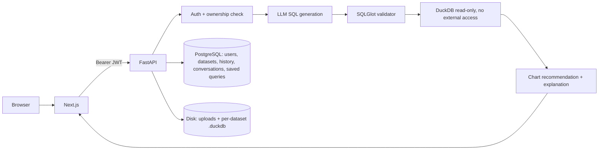

# Architecture

Modular monolith: Next.js frontend + FastAPI backend, PostgreSQL for metadata, one DuckDB file per dataset.

## Backend modules (`backend/app`)
- `core/` config (validated at startup), security (JWT), errors, rate limiter
- `models/`, `schemas/`, `db/` SQLAlchemy models, Pydantic contracts, Alembic migrations
- `services/` file ingestion, schema profiling, LLM provider, SQL generator, SQL validator, query executor, visualization, explanation, query orchestration
- `api/routes/` thin HTTP layer; routes never call the LLM SDK directly
- `storage/` local-disk storage (replace with an S3-compatible class for scalable deployments)

## Query pipeline
1. Ownership check on dataset (404 if not the owner).
2. Prompt = table schema + last 3 successful Q/SQL pairs of this conversation + question. Conversations are bound to one dataset.
3. LLM reply parsed against a JSON contract; SQL re-validated by AST allowlist.
4. Executed read-only with timeout and row cap; on validation/execution error one correction retry (configurable), validated from scratch.
5. Chart hint validated against real result columns, else heuristic; explanation generated from returned rows with a deterministic fallback.
6. Every attempt outcome is recorded in `query_history` (results are not stored).

## Frontend (`frontend/src`)
App Router pages (dashboard, datasets, workspace, history, saved, settings), a typed API client (`lib/api.ts`) that attaches the Clerk token, and reusable results table / chart / SQL editor components.
